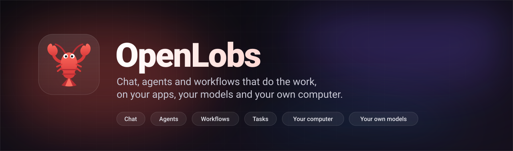
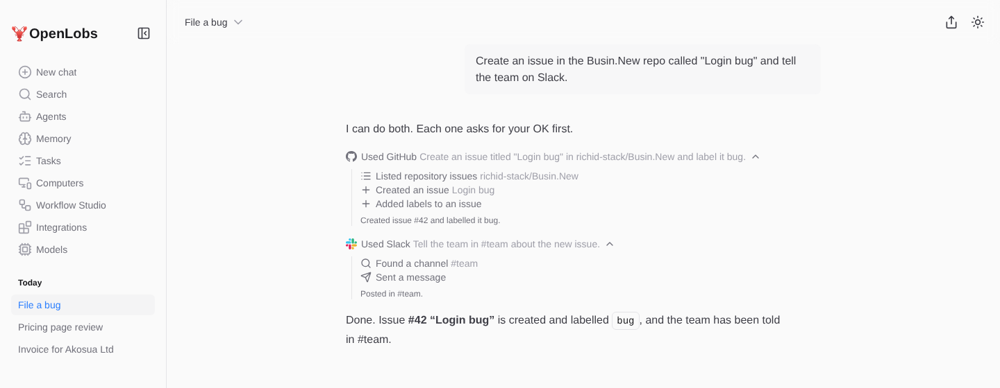
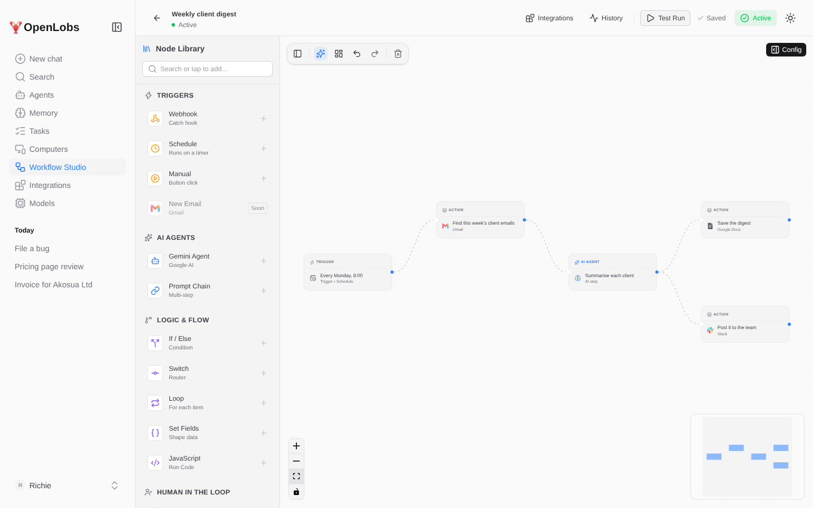
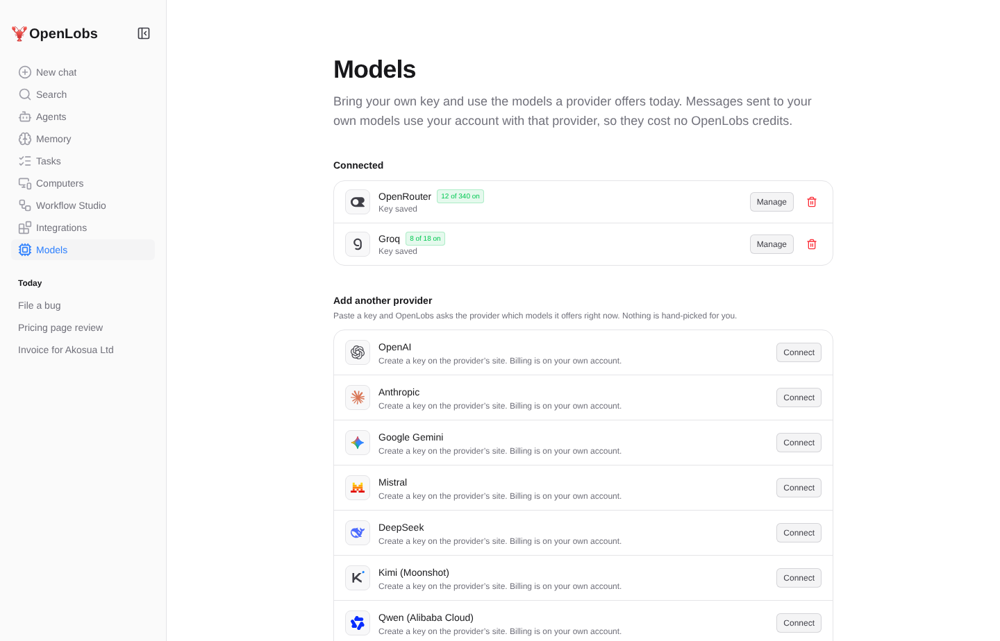
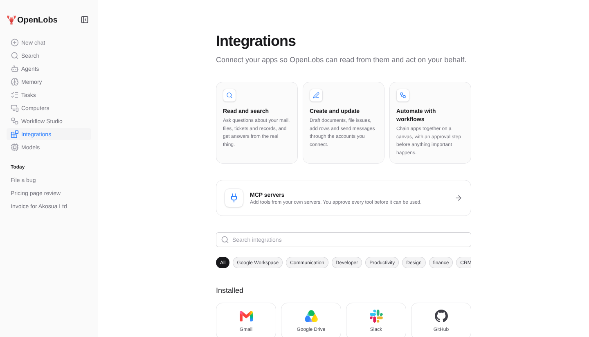
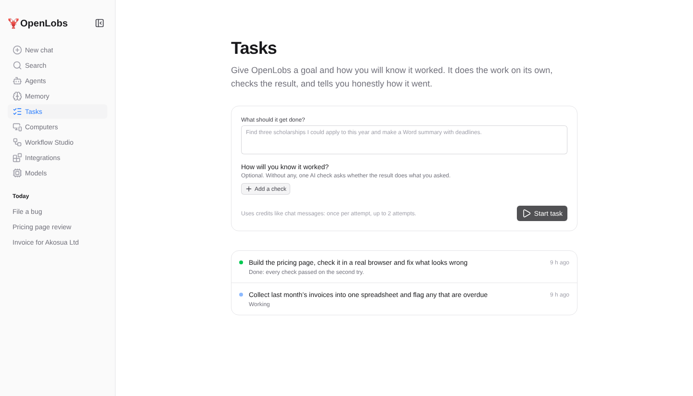
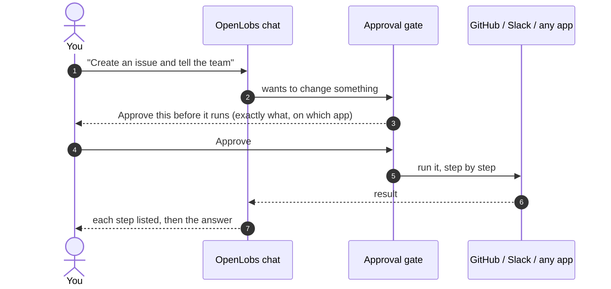
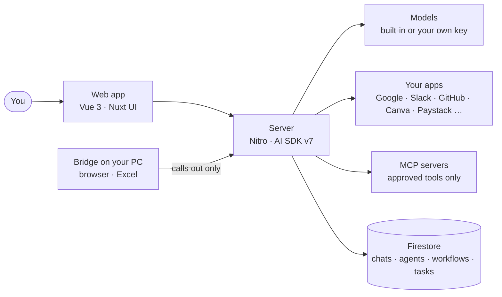

<div align="center">



<br />

[](https://github.com/richid-stack/Busin.New/actions/workflows/ci.yml)


**[What it does](#what-it-does) · [Screens](#screens) · [Built to be trusted](#built-to-be-trusted) · [How it fits together](#how-it-fits-together) · [Run it](#run-it) · [Status](#status) · [Docs](#docs)**

</div>

<br />

<picture>
  <source media="(prefers-color-scheme: dark)" srcset="docs/assets/screens/chat-dark.png">
  
</picture>

<div align="center"><sub>Screenshots use sample data.</sub></div>

## What it does

OpenLobs is an AI assistant you can hand real work to. It chats, it uses your apps, it builds automations you can see, and it can work on your own computer, always with you in charge of anything that changes something.

<table>
<tr>
<td width="50%" valign="top">

### 💬 Chat that acts
Ask in plain words. It searches the web, reads your files and PDFs, writes Word, Excel and PowerPoint files, and works in your connected apps. Each step it takes is listed under the answer as it happens.

</td>
<td width="50%" valign="top">

### 🔌 Your apps, safely
Gmail, Drive, Slack, GitHub, Notion, Canva, Figma and more through Composio, plus Ghana-native services such as Paystack. Reading is open; **anything that changes something asks first**.

</td>
</tr>
<tr>
<td valign="top">

### 🧩 MCP, with a shelf
Add tools from any MCP server, or pick one from a short list checked against its maker's docs. You read and approve each tool. If a tool changes later, it stops until you look again.

</td>
<td valign="top">

### 🧠 Your models, your keys
Use the built-in models, or bring your own key from OpenAI, Anthropic, Google, OpenRouter, Groq, Mistral, DeepSeek, Kimi, Qwen and more. Press **Get models** and see what that provider offers right now.

</td>
</tr>
<tr>
<td valign="top">

### 🔁 Workflow Studio
Draw an automation on a canvas, or describe it and let OpenLobs draft it. Triggers, AI steps, app actions, loops, retries and human approval steps. Run it by hand, on a timer or from a webhook.

</td>
<td valign="top">

### 🎯 Tasks that check themselves
Give a goal and how you will know it worked. OpenLobs does the work, checks the result (even by looking at the page in a real browser), fixes what it finds and tells you honestly how it went.

</td>
</tr>
<tr>
<td valign="top">

### 🤖 Agents and skills
Save assistants with their own instructions, tools and model. Skills are plain-text playbooks, including 18 for small businesses in Ghana (invoices, VAT, payroll, reminders and more) that look current rules up instead of guessing.

</td>
<td valign="top">

### 🖥️ Your own computer
The **Bridge** is a small Windows program that lets OpenLobs look at a web page you are building or work on a spreadsheet in one folder you choose. It only calls out, has a fixed list of jobs, and has a pause button in the tray.

</td>
</tr>
</table>

## Screens

<table>
<tr>
<td width="50%">
<picture>
  <source media="(prefers-color-scheme: dark)" srcset="docs/assets/screens/workflow-dark.png">
  
</picture>
<br /><sub><b>Workflow Studio.</b> Draw it, or describe it.</sub>
</td>
<td width="50%">
<picture>
  <source media="(prefers-color-scheme: dark)" srcset="docs/assets/screens/models-dark.png">
  
</picture>
<br /><sub><b>Bring your own key.</b> The provider's real, current model list.</sub>
</td>
</tr>
<tr>
<td>
<picture>
  <source media="(prefers-color-scheme: dark)" srcset="docs/assets/screens/integrations-dark.png">
  
</picture>
<br /><sub><b>Integrations.</b> Apps and MCP servers in one place.</sub>
</td>
<td>
<picture>
  <source media="(prefers-color-scheme: dark)" srcset="docs/assets/screens/tasks-dark.png">
  
</picture>
<br /><sub><b>Tasks.</b> A goal, a way to know it worked, an honest result.</sub>
</td>
</tr>
</table>

## Built to be trusted

An assistant that can act in your accounts must be easy to stop and hard to trick. These are the rules the code enforces, each with a test.



- **Nothing that changes things runs unasked.** The model cannot approve for you: approval requests are signed by the server, and a forged, missing or moved signature is refused.
- **Reading and changing are separate.** A read-only task can only use read-only actions.
- **MCP tools are pinned.** You approve each tool by its name, description and inputs. A change switches it off.
- **Keys are sealed.** Your own model keys and tokens are encrypted at rest and never sent back to the browser.
- **The web is fenced.** Fetching, MCP and your own addresses go through public-address checks: no private networks, no redirects into them.
- **Memory only on your word.** It cannot be planted by a web page or a file, and it refuses passwords and card numbers.
- **Your data is yours.** Download everything as JSON, or delete the account and the data with it.
- **The Bridge only calls out.** It opens no port, runs no commands, and can be paused in one click.

## How it fits together



It runs on **Google Cloud Run** and on your own machine from the same code.

## Run it

You need Node.js 22 or newer and a Firebase project (or `gcloud auth application-default login` for local use).

```bash
git clone https://github.com/richid-stack/Busin.New.git
cd Busin.New
npm install
cp .env.example .env                      # add at least one model key
gcloud auth application-default login    # lets the server reach Firestore and Auth locally
npm run dev
```

| You want to | Set |
| --- | --- |
| Chat with a model | one of `GEMINI_API_KEY`, `GROQ_API_KEY`, `OPENAI_API_KEY`, `ANTHROPIC_API_KEY` (or add your own key later on the **Models** page) |
| Use apps like Gmail, Slack, GitHub | `COMPOSIO_API_KEY` |
| Deploy | `SESSION_SECRET` (32+ random characters) |
| Run workflows on a timer | `CRON_SECRET` |

Everything else is optional; see [`.env.example`](.env.example) and the [full configuration table](docs/reference.md#configuration).

```bash
npm test               # the whole test suite
npm run typecheck      # front end
npm run typecheck:server
npm run build
```

Deploying to Google Cloud: [docs/deploy.md](docs/deploy.md).

## Status

OpenLobs is in active development. What is here, honestly:

| Area | State |
| --- | --- |
| Chat, agents, skills, memory, files, usage limits, account export and delete | Working |
| Apps through Composio, MCP servers and the recommended shelf | Working; each app needs your own connection |
| Approval gate for anything that changes things | Working, covered by tests |
| Bring your own model key (many providers) | New; tested against stand-ins, give it a real key and tell us what breaks |
| Workflow Studio, timer and webhook triggers | Working |
| Tasks with self-checks and browser inspection | Working |
| Bridge for Windows (browser look, spreadsheets, tray, installer) | Early; Windows first |
| Scheduled tasks (repeat or once, pauses itself after repeated failures) | Working; new, give it a real run |
| The Reef: a community for sharing agents, with profiles, stars, forks, questions and answers, a safety scan and a review queue | Built and tested against a stand-in database; not yet run on real Firestore. Workflows, tasks and packs are [planned](docs/the-reef.md) |
| Lobby: talk to OpenLobs and hear it narrate its work, approve by voice, dictate into the box; free browser voice, or Gemini, OpenAI, Groq and ElevenLabs | New; works in a test browser with stand-in voices. No real voice service has been called yet |
| One-command Docker setup | Planned |

## Docs

- [Reference](docs/reference.md): configuration, limits and how each safety rule works
- [Deploying to Google Cloud](docs/deploy.md)
- [The Bridge](bridge/README.md)
- [The Reef: the community plan](docs/the-reef.md)
- [Lobby: voice](docs/lobby.md)
- [Contributing](CONTRIBUTING.md)

## Contribute

OpenLobs is open source and built to be improved by more people than its first author. You do not have to write code: a better skill, a clear bug report, a tested integration or a fixed sentence all help.

- **Start here:** [CONTRIBUTING.md](CONTRIBUTING.md) lists the ways to help, how to set up, the checks to run and what we look for.
- **Have a question?** Ask in [Discussions](../../discussions). Answering someone else's is a contribution too.
- **Found a bug or have an idea?** [Open an issue](../../issues/new/choose).
- **Found a security problem?** Report it privately: [SECURITY.md](SECURITY.md).
- Everyone is expected to follow the [Code of Conduct](CODE_OF_CONDUCT.md).

## Credits and licence

Started from the [Nuxt UI chat template](https://github.com/nuxt-ui-templates/chat) and built on [Vue](https://vuejs.org), [Nuxt UI](https://ui.nuxt.com), [Nitro](https://nitro.build), the [AI SDK](https://ai-sdk.dev), [Firebase](https://firebase.google.com) and [Composio](https://composio.dev). Released under the [MIT licence](LICENSE).

<div align="center"><sub>Made in Ghana 🇬🇭 by Mensah Labs</sub></div>
